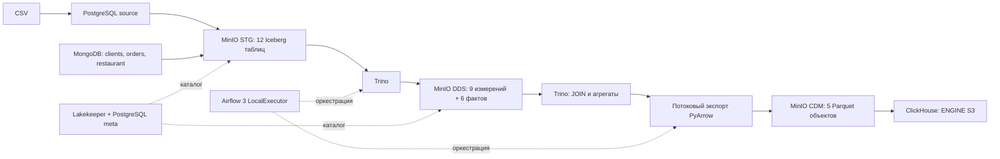

# Локальное хранилище: PostgreSQL + MongoDB → Iceberg → Parquet → ClickHouse

Учебный стенд по `warehouse-compose-spec.md`. На хосте нужны только Docker с
Linux-контейнерами и Docker Compose v2+. Все миграции, загрузки, SQL и тесты
выполняются в контейнерах. Windows поддерживается через Docker Desktop / WSL2;
Java, Python и Node.js на хост устанавливать не нужно.

## Быстрый запуск

Первый запуск скачивает образы и собирает MinIO из официального тега исходников.
Выделите Docker около 12–16 ГБ RAM и запас диска для образов и снимков Iceberg.
Доступ к реестрам образов, PyPI, npm и Go proxy нужен только при сборке.

Windows, PowerShell из корня репозитория:

```powershell
powershell -ExecutionPolicy Bypass -File scripts/warehouse.ps1 up
powershell -ExecutionPolicy Bypass -File scripts/warehouse.ps1 demo
powershell -ExecutionPolicy Bypass -File scripts/warehouse.ps1 smoke
```

Linux / macOS:

```sh
sh scripts/warehouse.sh up
sh scripts/warehouse.sh demo
sh scripts/warehouse.sh smoke
```

`up` создаёт `.env` из `.env.example`, собирает образы, выполняет bootstrap и
миграции и ждёт healthcheck. Он не добавляет бизнес-данные. `demo` явно запускает
идемпотентный seed, затем настоящий DAG `warehouse_pipeline` через Airflow API
и ждёт его результата. `smoke` проверяет точные ожидания демонабора.

Те же операции напрямую, без скриптов:

```sh
# Сначала скопируйте .env.example в .env: cp (Linux) / Copy-Item (PowerShell).
docker compose config --quiet
docker compose build warehouse-cli mongo-migrate minio
docker compose up -d
docker compose up -d --no-deps --wait airflow-api-server airflow-scheduler airflow-dag-processor trino clickhouse
docker compose run --rm --no-deps warehouse-cli demo
docker compose run --rm --no-deps smoke-test
```

| Интерфейс | Адрес | Учётные данные из `.env` |
|---|---|---|
| Airflow | http://localhost:8080 | `AIRFLOW_ADMIN` / `AIRFLOW_ADMIN_PASSWORD` |
| Trino | http://localhost:8081 | Любое имя, например `warehouse_etl` |
| MinIO Console | http://localhost:9001 | `MINIO_ROOT_USER` / `MINIO_ROOT_PASSWORD` |
| MinIO API | http://localhost:9000 | Ключи S3 из `.env` |
| ClickHouse HTTP / Play | http://localhost:8123/play | `CLICKHOUSE_READ_USER` / `CLICKHOUSE_READ_PASSWORD` |

В примере Airflow: `admin` / `demo_airflow_password`; ClickHouse для отчётов:
`report_reader` / `demo_report_reader_password`. Это открыто опубликованные
локальные демонстрационные значения. `.env` исключён из Git. Все порты привязаны
к `127.0.0.1`; номера задаются в `.env`. PostgreSQL source доступен на 15432,
MongoDB — 27017, каталог — 8181. Внутри Compose используются DNS-имена сервисов.
Lakekeeper и Trino работают без внешнего IdP: стенд рассчитан на доверенную
локальную машину. Для внешнего доступа нужны отдельная настройка доступа и TLS.

## Архитектура и физическое хранение



| Слой | Размещение / назначение |
|---|---|
| Источник магазина | `postgres-source`, БД `craft`, пять таблиц `public`; `"order"` всегда экранируется |
| Внешние данные | `external_source.order_statuses`, `user_behavior`, `marketing_research` — ровно три таблицы |
| Журнал | `public.logs`, история зафиксированных изменений обеих бизнес-схем |
| Ресторанный источник | MongoDB, БД `restaurant`, три коллекции с валидаторами и индексами |
| STG | Iceberg v2 / Parquet, `s3://dwh/stg/<table-uuid>/…`, типизированные поля + полный исходный JSON |
| DDS | Iceberg v2 / Parquet, `s3://dwh/dds/<table-uuid>/…`, текущие звёзды SCD1 |
| CDM | `s3://dwh/cdm/<mart>/current.parquet`, обычный Parquet |
| Архив CSV | `s3://dwh/input/<sha256>/<original-file-name>.csv`, все исходные колонки |
| Управление | Отдельная БД `warehouse_control`: batch, количества, снимки, статусы публикаций, история lake-миграций |
| Каталог / Airflow | Отдельные БД `iceberg_catalog` и `airflow` в `postgres-meta` с отдельными логинами |

Имена таблиц, поля, типы и nullability перечислены в `src/warehouse/contracts.py`.
DDL lake-миграции зафиксирован отдельно в `migrations/lake/001_initial.json`.
Бизнес-таблиц MergeTree нет: все пять `cdm.*` имеют движок S3. Собственные системные
таблицы ClickHouse и служебная таблица версий Alembic могут использовать MergeTree.

У каждой звезды свои ключи: `craft:client:1`, `restaurant:client:1`,
`external:client:1` не соединяются друг с другом. Предложение мастера — отдельный
факт, заказ — отдельный факт с одной строкой на `order_id`. Для внешней активности
сначала агрегируются два независимых факта, затем выполняется FULL JOIN.

## Зафиксированные версии

| Компонент | Версия |
|---|---|
| Airflow / Python runtime | `apache/airflow:3.3.2-python3.12`, LocalExecutor, parallelism=2 |
| PostgreSQL | `postgres:17.11` |
| MongoDB | `mongo:8.0.34` |
| Lakekeeper | `quay.io/lakekeeper/catalog:v0.13.6` |
| Trino | `trinodb/trino:476` |
| ClickHouse | `clickhouse/clickhouse-server:26.8.1.2041` |
| MinIO | `RELEASE.2025-10-15T17-29-55Z` |
| MinIO Client | `RELEASE.2025-08-13T08-35-41Z` |
| Сборка MinIO | Go `1.24.8-bookworm`; runtime `alpine:3.22.2` |
| migrate-mongo / Node | `14.0.7` / `22.20.0-bookworm-slim`, MongoDB driver `6.20.0` |
| PyIceberg / PyArrow | `0.12.0` / `25.0.1` |
| Alembic / SQLAlchemy | `1.20.0` / `2.0.52` |
| psycopg / PyMongo | `3.3.5` / `4.18.1` |
| trino-python / clickhouse-connect | `0.339.0` / `1.8.0` |

Прямые Python-зависимости — `requirements.txt`, полный проверенный набор —
`requirements.lock`; оба ограничения используются при сборке. Официальный constraints-файл
Airflow 3.3.2 / Python 3.12 сохранён в `docker/airflow/constraints-3.12.txt`.
Npm-зависимости фиксирует `migrations/mongo/package-lock.json`, сборка использует
`npm ci`. Установка пакетов при старте контейнеров не выполняется.

MinIO и `mc` собираются из официальных тегов: выбранный тег `minio/mc` отсутствовал
в Docker Hub. Это не меняет S3-архитектуру. Для PyIceberg явно выбран
`X-Iceberg-Access-Delegation: client-managed`, Arrow FileIO и собственные ключи
ETL. Пустой заголовок в Lakekeeper 0.13.6 включает fallback на remote signing.
Trino использует native S3 и отключённые vended credentials. ClickHouse получает
ключи пользователя чтения через server-side named collection `warehouse_s3`;
секретов в SQL миграций нет.

Проверенные первичные источники: [Airflow 3.3.2 Docker](https://airflow.apache.org/docs/apache-airflow/3.3.2/howto/docker-compose/index.html),
[constraints 3.3.2](https://github.com/apache/airflow/blob/constraints-3.3.2/constraints-3.12.txt),
[Trino 476 Iceberg](https://trino.io/docs/476/connector/iceberg.html),
[Lakekeeper: режимы S3-доступа](https://docs.lakekeeper.io/docs/latest/storage/),
[PyIceberg configuration](https://py.iceberg.apache.org/configuration/),
[ClickHouse Alembic](https://clickhouse.com/docs/integrations/language-clients/python/sqlalchemy),
[ClickHouse S3](https://clickhouse.com/docs/engines/table-engines/integrations/s3),
[MinIO](https://github.com/minio/minio/tree/RELEASE.2025-10-15T17-29-55Z),
[mc](https://github.com/minio/mc/tree/RELEASE.2025-08-13T08-35-41Z).

## Операции после первого запуска

Скрипты Windows и Linux принимают одинаковые команды:

| Команда | Действие |
|---|---|
| `up` | Сборка и запуск с healthcheck; без seed |
| `migrate` | Повторный запуск всех bootstrap/migration jobs на работающем окружении |
| `seed` | Явное наполнение источников, без запуска DAG |
| `demo` | Seed + реальный запуск DAG с ожиданием результата |
| `run` | Реальный запуск DAG на текущих источниках |
| `smoke` | Проверки чтения, схем, всех пяти витрин и golden-данных |
| `test` | Полные приёмочные тесты с изменениями демонстрационных источников |
| `status` | Контейнеры, версии Alembic, состояния batch и публикаций |
| `stop` | Остановить контейнеры, сохранив данные |
| `down` | Удалить контейнеры и сеть, сохранив named volumes |

После изменения миграций сначала соберите новые образы, затем явно выполните
`migrate`; не полагайтесь на ранее завершившиеся init-контейнеры:

```sh
docker compose build
docker compose run --rm --no-deps postgres-migrate
docker compose run --rm --no-deps mongo-migrate
docker compose run --rm --no-deps control-migrate
docker compose run --rm --no-deps lake-migrate
docker compose run --rm --no-deps clickhouse-migrate
```

Полный порядок повторной подготовки реализован командой `migrate` обоих скриптов.
Не выполняйте миграции и тесты параллельно с обычной загрузкой. Расписание DAG
настраивается `AIRFLOW_SCHEDULE` (пусто = ручной запуск); `max_active_runs=1`.
Изменение env требует пересоздания соответствующих контейнеров. Смена паролей
на существующих volumes требует явного изменения ролей: `.env` не является
автоматической системой ротации паролей.

Повтор конкретного batch для диагностики, без планировщика:

```sh
docker compose run --rm --no-deps warehouse-cli pipeline --run-id local-debug-1
```

Повтор той же команды использует тот же UUID batch. Основной пользовательский
путь — `run` / `trigger` через Airflow, где сохраняется история отдельных задач.
Логи доступны в UI и через `docker compose logs airflow-scheduler`.

## Контракты данных и вычислений

`SOURCE_TIMEZONE` задаёт пояс входных строк без offset, `REPORT_TIMEZONE` —
календарные границы отчёта; по умолчанию оба UTC. В STG timestamps хранятся в UTC.
Неоднозначное или несуществующее локальное время при переходе DST отклоняется.
Неизвестные даты не превращаются в текущую дату. День рождения — календарная DATE.
Деньги источников — `NUMERIC/Decimal128(18,2)`, итоговые суммы — `Decimal(38,2)`;
двоичный float для денежных значений MongoDB отклоняется.

Месячный отчёт `craft_customer_monthly`:

- завершения, средняя цена, медиана, популярные категория и мастер относятся к
  месяцу фактического `delivery_date` заказов `done`;
- создания, `in_progress`, незавершённые относятся к месяцу `order_date`;
  `cancelled` также незавершённый, то есть `status <> 'done'`;
- месяцы — объединение месяцев создания и завершения, поэтому клиент без
  завершений имеет строку с нулевым числом завершений и NULL-средней/медианой;
- сумма всех оплаченных заказов определяется по `paid_at IS NOT NULL`, независимо
  от статуса, за всю доступную историю; повторяется во всех месячных строках клиента;
- цена заказа фиксируется триггером при INSERT; обновление предложения её не меняет;
- медиана точная: сортировка длительностей в миллисекундах и середина массива /
  среднее двух середин. Результат в днях округляется до четырёх знаков;
- категории без значения исключены; равные частоты разрешаются лексикографически,
  мастера — по минимальному ID; ID отчёта стабилен и включает домен клиента;
- `orders_count_month = completed_orders_count_month`. Весь контракт содержит 17 полей.

Независимый запрос для источника — `sql/source/craft_customer_monthly.sql`.
Он выполняется на PostgreSQL без lake и без внешних таблиц. Для другого пояса
перед запросом выполните `SET warehouse.report_timezone = 'Europe/Moscow'`.
Trino SQL и четыре другие витрины находятся в `sql/cdm/`.
Точные ожидания и объяснения — `tests/fixtures/README.md`.

Для старых заказов новая миграция оставляет неизвестный `order_price` NULL.
ETL остановится с ошибкой качества; заполнять такую цену текущим предложением
задним числом нельзя. Нужен подтверждённый источник исторической цены и отдельная
явная корректировка. В новом источнике допустимы `created`, `in_progress`,
`delivery`, `done`, `cancelled`; преобразование STG также нормализует старое
написание `in progress` в `in_progress`.

CSV загружаются командой `seed --csv-dir /opt/warehouse/<directory>` внутри
`warehouse-cli`; положите входные файлы в каталог проекта. Этот seed также
восстанавливает фиксированный демонабор магазина и MongoDB, поэтому предназначен
для учебного стенда. Файлы должны называться `order_statuses.csv`,
`user_behavior.csv`, `marketing_research.csv`. У `user_behavior` преобразуются
`Id → id`, `user_id → client_id`; остальные исходные колонки остаются в архиве.
Для marketing технический положительный bigint строится из SHA-256 всей исходной
строки и номера её точного повтора. Идентичные исходные записи сохраняются раздельно,
перестановка строк не меняет набор ID; коллизия вызывает явную ошибку.
`date_id` проверяется как настоящая дата YYYYMMDD. Никакого связывания CSV-клиентов
с клиентами магазина по совпавшему числу нет.

Пример импорта файлов из каталога `my-input` в корне проекта:

```sh
docker compose run --rm --no-deps warehouse-cli seed --csv-dir /opt/warehouse/my-input
docker compose run --rm --no-deps warehouse-cli trigger
```

## Надёжность, миграции и границы версии

PostgreSQL извлекается одним read-only REPEATABLE READ снимком: восемь бизнес-таблиц
и журнал. Используются серверные курсоры и порции по 1000 строк. MongoDB читается
порциями по 1000 с сохранением полного canonical Extended JSON, включая ObjectId,
Decimal128 и `ordered_dish`. Это полные снимки, а не CDC MongoDB: промежуточные
версии документов между запусками не сохраняются. Единого снимка между разными
источниками и коллекциями MongoDB нет.

STG сохраняет предыдущие batch; retry атомарно заменяет строки своего batch в
каждой таблице. `pg_logs` каждый раз полностью перечитывается и заменяется по
уникальному `log_id`: watermark по `max(id)` не применяется. Поэтому поздний commit
транзакции с меньшим sequence ID не теряется. Аудит выполняется AFTER ROW для
INSERT/UPDATE/DELETE (NEW/OLD), BEFORE TRUNCATE сохраняет каждую удаляемую строку.
События откатываются вместе с бизнес-транзакцией. Миграционные и служебные таблицы
не журналируются.

DDS обновляется Trino через атомарную замену каждой Iceberg-таблицы. Измерения
строятся перед фактами, проверяются ключи, обязательные поля и ссылки. Общей
транзакции на все 15 таблиц нет; CDM запускается только после полного DDS-barrier.
SQL расчёта выполняется в Trino; Python только проверяет и экспортирует результаты
порциями в явную Arrow-схему.

Сначала готовятся все пять временных Parquet-файлов. Только после проверки схем,
строк и уникальности ключей целиком заменяются `current.parquet`; старый объект
заранее не удаляется. Сбой подготовки оставляет все старые витрины читаемыми.
Замена атомарна для одного S3-объекта. Сбой между загрузками разных объектов может
оставить смешанные поколения: статусы/ETag/хеш каждой витрины есть в
`warehouse_control.publications`, весь batch успешен только после чтения и сверки
всех пяти витрин из ClickHouse. Retry заново подготовит и опубликует полный набор.
Query cache и filesystem cache ClickHouse отключены; тест изменения оплаты
проверяет свежесть результата сразу после замены объекта.

У Alembic PostgreSQL, control и ClickHouse независимые истории. DDL ClickHouse
нетранзакционный; миграции повторяемы при частичном сбое, под advisory lock в
control. MongoDB использует migrate-mongo с историей и хешем файлов. Lake runner
использует advisory lock, checksum, running/success/failed и проверяет существующую
схему перед продолжением. Применённые ревизии не редактируются: расширения делаются
новыми ревизиями. Airflow и Lakekeeper мигрируют собственными штатными средствами.

Volumes `pg_source`, `pg_meta`, `mongo_data`, `minio_data`, `clickhouse_data`,
`airflow_logs` сохраняют данные, каталог и историю. Обычная остановка:

```sh
docker compose down
```

**Полное удаление данных**, только для сознательного сброса учебного окружения:

```sh
docker compose down --volumes
```

Скрипты запуска и миграции эту разрушительную команду не выполняют. Старые batch,
Iceberg snapshots и orphan-файлы после неудачных записей автоматически не удаляются:
для длительной эксплуатации нужна отдельная политика retention/maintenance.

## Проверки

```sh
docker compose run --rm --no-deps smoke-test
docker compose run --rm --no-deps warehouse-cli test
```

`smoke` только читает данные и рассчитан на seed. `test` предназначен для демостенда:
временно меняет оплату/цену, удаляет заказ, запускает DAG, проверяет fault injection
и восстанавливает seed в `finally`. На произвольных пользовательских данных
запускайте проверки чтения, адаптировав golden-ожидания; полные тесты восстанавливают
именно демонстрационные строки. Для видимого вывода pytest можно задать его через
отдельный entrypoint контейнера, хостовый Python не нужен.

История MongoDB: `docker compose run --rm --no-deps mongo-migrate status`.
Контрольный JSON состояния для сравнения после перезапуска:
`docker compose run --rm --no-deps warehouse-cli fingerprint`.

Проверяются все 17 полей PostgreSQL ↔ Trino ↔ ClickHouse, четыре дневные витрины,
тип Parquet, движок S3, доменная изоляция, JOIN без размножения, чётная/нечётная
медиана, переход месяца, независимые оплаты, неизменность исторических цен,
повторные DAG и batch, отбраковка плохих дат/неизвестной цены, сохранение старой
публикации при сбое, аудит обеих схем и поздний commit. Фактически выполненные
запуски и результаты описаны в `VALIDATION.md`.
