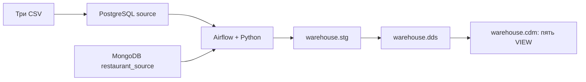

# Учебное PostgreSQL-хранилище

Магазин и три CSV находятся в отдельном PostgreSQL-источнике. Ресторанные документы находятся в MongoDB. Airflow раз в час применяет новые события PostgreSQL из `public.logs`, переносит текущий снимок MongoDB и обновляет PostgreSQL `warehouse`: `stg` → `dds` → пять обычных `cdm` VIEW.



## Запуск

Нужны Docker Desktop с Linux-контейнерами, Docker Compose 2.24.4+ и PowerShell. Для стека желательно выделить Docker 8 ГБ RAM. Все команды выполняются из корня проекта.

```powershell
powershell -NoProfile -ExecutionPolicy Bypass -File scripts/bootstrap.ps1
```

Скрипт дополняет локальный `.env` настройками из `.env.example`, генерирует случайные пароли для пустых/отсутствующих значений, собирает образ, ждёт БД, применяет миграции, загружает demo/CSV, инициализирует Airflow, запускает DAG через API и проверяет витрины. При ошибке останавливается. Существующие непустые настройки сохраняются; `.env` исключён из Git и образа.

Airflow: http://127.0.0.1:8080. Логин и пароль находятся в локальном `.env`: `AIRFLOW_ADMIN`, `AIRFLOW_ADMIN_PASSWORD`. Используется SimpleAuthManager для учебного локального запуска. DAG `warehouse_refresh` содержит одну задачу `refresh_warehouse`, `max_active_runs=1`; LocalExecutor имеет `parallelism=2`.

Порты можно изменить в `.env` до запуска:

| Сервис | Адрес по умолчанию | Настройка |
|---|---|---|
| Airflow | `127.0.0.1:8080` | `AIRFLOW_PORT` |
| PostgreSQL source | `127.0.0.1:5433` | `SOURCE_PORT` |
| PostgreSQL warehouse | `127.0.0.1:5434` | `DWH_PORT` |
| MongoDB | `127.0.0.1:27017` | `MONGO_PORT` |

В контейнерах используются имена сервисов и внутренние порты 5432/27017. `SOURCE_TIMEZONE` применяется к исходным строковым датам без зоны. По умолчанию это `Europe/Moscow`; существующий `.env` может задавать другое значение. Отчёты всегда используют UTC. `AIRFLOW_SCHEDULE` по умолчанию равен `@hourly`.

Изменения Python, SQL и DAG попадают в образ при сборке. После изменения кода выполните `docker compose build migrate`, затем `docker compose up -d --wait airflow-api-server airflow-scheduler airflow-dag-processor`. Init-скрипты PostgreSQL выполняются только для пустого тома; смена пароля в `.env` сама по себе не меняет пароль уже созданного пользователя БД.

## Отдельные команды

```powershell
# Подготовка настроек и образа
powershell -NoProfile -ExecutionPolicy Bypass -File scripts/init-env.ps1
docker compose build migrate
docker compose up -d --wait postgres-source postgres-dwh mongo-source

# Две независимые истории Alembic и идемпотентный MongoDB bootstrap
docker compose run --rm migrate

# Демонстрационные данные; эта команда не входит в расписание DAG
docker compose run --rm seed

# Собственная служебная БД Airflow
docker compose run --rm airflow-init
docker compose up -d --wait airflow-api-server airflow-scheduler airflow-dag-processor

# Настоящий запуск DAG с ожиданием результата
docker compose run --rm smoke-test python -m airflow_utils.run_dag

# Та же загрузка без Airflow для диагностики
docker compose run --rm smoke-test python -m airflow_utils.refresh

# Проверки и примеры строк всех пяти витрин
docker compose run --rm smoke-test

# Статус и журналы
docker compose ps
docker compose logs --tail 100 airflow-scheduler airflow-dag-processor

# Остановка с сохранением данных
docker compose down
```

Миграции PostgreSQL можно запускать отдельно:

```powershell
docker compose run --rm migrate alembic -c alembic-source.ini upgrade head
docker compose run --rm migrate alembic -c alembic-warehouse.ini upgrade head
docker compose run --rm migrate python -m warehouse.bootstrap_mongo
```

Код выполнения DAG собран в пакете `src/airflow_utils`: `refresh.py`, `loader.py`, адаптеры источников и `validation.py`. Здесь же находятся команды Airflow `airflow_entrypoint.py` и `run_dag.py`. Определение DAG — `dags/warehouse_refresh.py`; общие настройки, миграции, seed и импорт CSV — в `src/warehouse`.

## Данные и права

`postgres-source` содержит `source`, `postgres-dwh` — отдельные БД `warehouse` и `airflow`. Данные сохраняются в named volumes `pg_source_v3`, `pg_dwh_v3`, `mongo_source_v3`, `airflow_logs_v3` с префиксом Compose-проекта.

| Назначение | Настройки пользователя |
|---|---|
| Миграции источника и DWH | `SOURCE_ADMIN`, `DWH_ADMIN` |
| Изменение исходных данных, seed/CSV | `SOURCE_APP_USER` |
| Чтение PostgreSQL-источника | `SOURCE_ETL_USER` |
| Чтение MongoDB-источника | `MONGO_ETL_USER` |
| Обновление STG/DDS | `DWH_ETL_USER` |
| Только чтение пяти CDM-вьюх | `REPORT_USER` |
| Метаданные Airflow | `AIRFLOW_DB_USER` |

Миграционные пользователи владеют объектами. ETL не меняет структуру. Прикладной пользователь источника не может изменять или очищать `public.logs`; audit-функции пишут журнал с правами владельца. У читателя отчётов нет доступа к STG/DDS. MongoDB admin используется только bootstrap/seed.

Истории Alembic хранятся в `migration_meta` каждой БД. Ревизия `s001` создаёт исходную модель, сокращённые CSV-таблицы и аудит; `s002` явно добавляет email, цену заказа и момент оплаты; `s003` ограничивает ETL-читателя журналом `public.logs`. Ревизии warehouse создают STG/DDS, функции разбора BSON/дат и вьюхи; `w003` разделяет общее и завершённое количество заказов. SQL каждой ревизии зафиксирован рядом с ней. `sql/cdm/views.sql` — удобная копия запросов; изменение этого файла не изменяет уже применённую миграцию. Для изменения модели или вьюх добавляется новая ревизия.

## Правила загрузки

1. Session advisory lock допускает одного writer, включая ручной запуск. Блокировка берётся до чтения источников.
2. PostgreSQL-читатель имеет доступ только к `public.logs`. В транзакции `REPEATABLE READ READ ONLY` сначала читаются идентификаторы событий, затем только отсутствующие в `stg.pg_logs` строки. Watermark по `max(id)` не используется: более низкий sequence ID может закоммититься позже более высокого.
3. Новые события PostgreSQL по порядку применяются к STG: `INSERT` и `UPDATE` заменяют строку по бизнес-ключу, `DELETE` и `TRUNCATE` удаляют её. Исходный JSON каждого события сохраняется в `stg.pg_logs`. MongoDB-коллекции читаются полными снимками последовательно.
4. В одной транзакции warehouse применяются события PostgreSQL, заменяется MongoDB STG, затем перестраивается DDS: сначала удаляются факты, затем измерения; вставка идёт в обратном порядке.
5. Проверяются количества строк, связи, предложение мастер–товар, зерно месячной витрины и типы объектов CDM. Ошибка откатывает STG/DDS и новые записи журнала вместе.

Обычный SELECT из CDM видит последнее зафиксированное состояние; `REFRESH` не нужен. Удаление источника отражается после следующей успешной загрузки. Объём рассчитан на небольшой учебный набор: снимки хранятся в памяти, данные переносятся через COPY/пакетную вставку. Через XCom данные не передаются.

Между PostgreSQL и MongoDB нет общей транзакции. Последовательное чтение трёх MongoDB-коллекций также не даёт единого снимка. Промежуточные версии MongoDB не сохраняются; отсутствие связанного документа приводит к ошибке и сохранению прошлого warehouse-снимка.

Исходные MongoDB-документы целиком лежат в `stg.mongo_*` в canonical Extended JSON, включая ObjectId, BSON Date, Decimal128 и массив `ordered_dish`. JSON-журнал PostgreSQL переносится как текст JSON без промежуточного преобразования чисел в `float`. Деньги DDS — `NUMERIC(18,2)`, деньги Python — `Decimal`/`Decimal128`.

SQL поддерживает BSON Date и строковые даты `dd.mm.yyyy`, `dd.mm.yyyy hh:mm:ss`, ISO 8601. Моменты без зоны получают `SOURCE_TIMEZONE`, затем переводятся в UTC. Даты рождения и основания остаются календарными датами. Некорректные даты завершают загрузку ошибкой.

## CSV и seed

Полные исходные CSV хранятся в `seeds/csv/`. В `external_source` переносятся только поля из ТЗ. Заголовки нормализуются по регистру и пробелам. `Id` переходит в `id`, `user_id` — в `client_id`. Одна строка поведения равна одному событию; исходная `quantity` поведения не используется.

Маркетинговый `date_id` имеет строго формат `YYYYMMDD`; `id` равен номеру строки данных, начиная с 1. Дубликаты исходных ID приводят к ошибке. Повторный seed/импорт не обновляет неизменившиеся строки PostgreSQL и не создаёт лишних событий аудита.

Demo резервирует ID 1–6 клиентов магазина, 1–2 мастеров/товаров, 1–3 предложений, 1–11 заказов и фиксированные ObjectId из `seed.py`. Seed восстанавливает эти демонстрационные записи; для реальных источников его не запускают. Посторонние бизнес-строки и документы не удаляются.

CSV трактуется как полный набор. При изменении состава ключей непустого набора обычный seed откажется его перезаписывать. Явная замена всех трёх CSV-наборов выполняется отдельно:

```powershell
docker compose build migrate
docker compose run --rm seed python -m warehouse.csv_import --replace
docker compose run --rm smoke-test python -m airflow_utils.run_dag
```

Эта команда обновляет изменённые строки, добавляет новые и удаляет отсутствующие в файлах строки только из трёх `external_source`-таблиц. Смена порядка строк маркетинга считается заменой набора, а не CDC. Пустые файлы отклоняются, чтобы случайная потеря CSV не очищала источник. Все три импорта PostgreSQL выполняются в одной транзакции.

## Расчёты CDM

`cdm.craft_customer_monthly` содержит ровно 17 полей из ТЗ. Зерно — клиент магазина × месяц UTC, ID — `md5('craft:' || client_id || ':' || YYYY-MM)`.

Месячные показатели относятся к двум разным когортам. Число созданных, незавершённых и находящихся в процессе заказов относится к месяцу **создания**. Число завершённых, средняя цена, медиана длительности и популярность относятся к месяцу фактического **завершения**. Заказ 31 января → 1 февраля создаёт январскую и февральскую строки. Текущие статусы в когорте создания не являются историческими статусами на конец месяца.

Сумма оплат — за всю доступную историю клиента, по `paid_at IS NOT NULL`, независимо от статуса. Оплаченный незавершённый заказ входит в сумму, неоплаченный завершённый — нет. Сумма одинаково повторяется во всех месяцах клиента. `orders_count_month` содержит все заказы, созданные в отчётном месяце, а `completed_orders_count_month` — завершённые в этом месяце; показатели независимы.

Месяцы формируются объединением месяцев создания и завершения. При отсутствии завершённых заказов счётчики равны 0, средняя цена, медиана, категория и мастер — NULL. `cancelled` входит в незавершённые. Клиент без заказов не получает искусственных строк.

Медиана вычисляется `percentile_cont(0.5)` по длительности в секундах / 86400, с дробными днями. При равной популярности категория выбирается с `COLLATE "C"`, мастер — с минимальным числовым ID. Категория и мастер ранжируются независимо.

Цена фиксируется BEFORE INSERT trigger по паре `(master_id, product_id)` до AFTER-аудита. Изменение текущего предложения не меняет старую цену заказа. Для `done` обязательна фактическая дата завершения не раньше создания; у остальных статусов она отсутствует.

| Вьюха | Зерно и правила |
|---|---|
| `restaurant_daily_sales` | День UTC × ресторан, только `closed`; количества, cost/payment/bonus |
| `external_client_activity_daily` | День UTC × внешний клиент; два факта сначала агрегируются отдельно, затем FULL JOIN |
| `marketing_daily_sales` | День × весь маркетинговый набор |
| `external_order_statuses_daily` | День UTC × внешний клиент; quantity/payment_amount |

Ключи измерений равны исходным бизнес-ID. Магазин, ресторан и внешние клиенты имеют отдельные измерения: совпадающий ID не означает одного человека. Атрибуты измерений актуальные, SCD1; текущий адрес или категория могут измениться в отчётах прошлых месяцев. `logs` не участвует в суммировании фактов.

## SQL-запросы

Подключитесь SQL-клиентом к `127.0.0.1:5434`, БД из `DWH_DB`, пользователем `REPORT_USER` с `REPORT_PASSWORD`. Этих прав достаточно для всех запросов:

```sql
SELECT * FROM cdm.craft_customer_monthly ORDER BY report_period, client_id;
SELECT * FROM cdm.restaurant_daily_sales ORDER BY report_date, restaurant_id;
SELECT * FROM cdm.external_client_activity_daily ORDER BY report_date, client_id;
SELECT * FROM cdm.marketing_daily_sales ORDER BY report_date;
SELECT * FROM cdm.external_order_statuses_daily ORDER BY report_date, client_id;
```

Ожидаемые значения demo: клиент магазина 1 в феврале — 3 завершённых заказа, среднее 133.33, медиана 1 день; клиент 2 — медиана 2 дня; клиент 4 — 1.5 дня. Клиент 3 имеет оплату 300 при отсутствии завершённых заказов. Внешний клиент 1 за 1 февраля — quantity 5, payment_amount 50.30, 2 события поведения. Маркетинг за этот день — sales_qty 5, sales_amt 300.30.

## Проверки

```powershell
powershell -NoProfile -ExecutionPolicy Bypass -File scripts/test.ps1
```

Скрипт создаёт отдельный случайно названный Compose-проект с пустыми томами и без публикации портов БД. 19 интеграционных тестов проверяют чистые/повторные миграции и seed, событийную загрузку PostgreSQL только через `logs`, аудит восьми таблиц, COPY, массовые изменения, TRUNCATE, rollback, поздний commit журнала, удаления источников, точность денег, BSON и старые даты, CSV, отдельные ID-домены, месячные когорты, медианы, популярность, цены, права, один writer и видимость обычных VIEW. В конце удаляются только контейнеры и тома этого тестового проекта. Основной проект и старые тома не затрагиваются.

Фактически проверено 30.10.2026 на чистом Compose-проекте: сборка образа и `pip check`, миграции пустых БД, seed/CSV, событийная загрузка PostgreSQL, MongoDB snapshot и все 19 интеграционных тестов. Тесты исполнялись в Linux-контейнерах с Python 3.12; локальный `.venv` для запуска не требуется.

## Версии и документация

| Компонент | Зафиксированная версия |
|---|---|
| PostgreSQL | `postgres:17.11` |
| MongoDB | `mongo:8.0.34` |
| Airflow / Python | `apache/airflow:3.3.2-python3.12` |
| psycopg / psycopg-binary | `3.3.5` |
| PyMongo | `4.18.1` |
| SQLAlchemy | `2.0.52` |
| Alembic | `1.20.0` |
| python-dotenv / tzdata | `1.2.3` / `2026.4` |

Дополнительные пакеты устанавливаются при сборке. Версии согласованы с [constraints Airflow 3.3.2 / Python 3.12](https://raw.githubusercontent.com/apache/airflow/constraints-3.3.2/constraints-3.12.txt). Использованы документация [Airflow Docker](https://airflow.apache.org/docs/apache-airflow/3.3.2/howto/docker-compose/index.html), [LocalExecutor](https://airflow.apache.org/docs/apache-airflow/3.3.2/core-concepts/executor/local.html), [SimpleAuthManager](https://airflow.apache.org/docs/apache-airflow/3.3.2/core-concepts/auth-manager/simple/index.html), [PostgreSQL VIEW](https://www.postgresql.org/docs/17/sql-createview.html), [агрегатов PostgreSQL](https://www.postgresql.org/docs/17/functions-aggregate.html), [Alembic](https://alembic.sqlalchemy.org/en/latest/cookbook.html) и [MongoDB Extended JSON](https://www.mongodb.com/docs/languages/python/pymongo-driver/current/data-formats/extended-json/).
