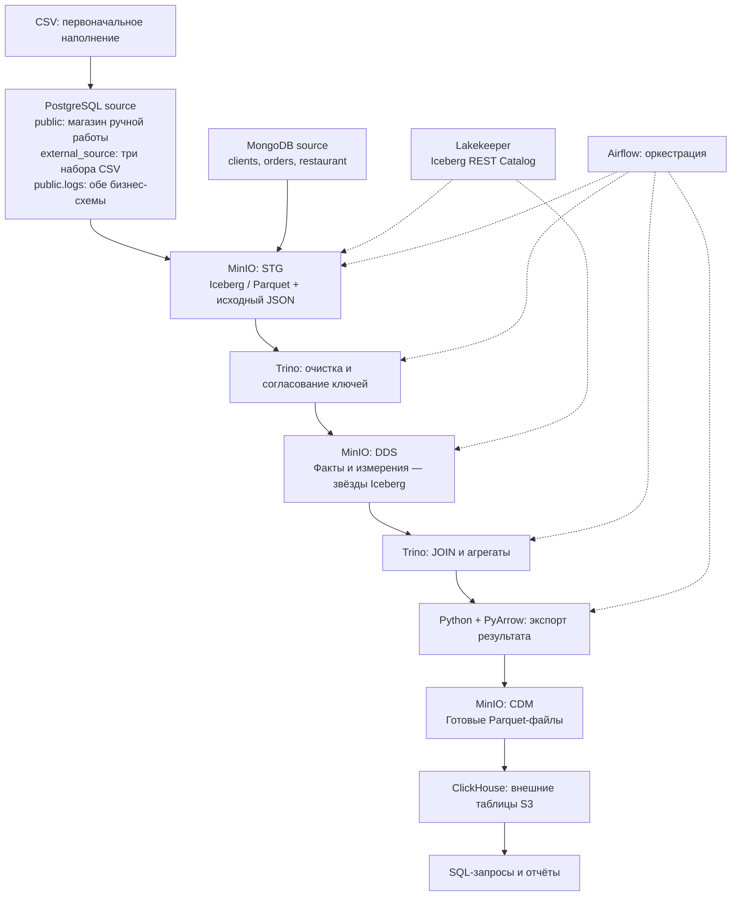
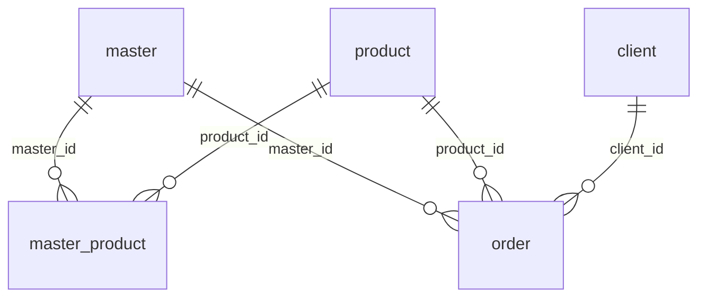
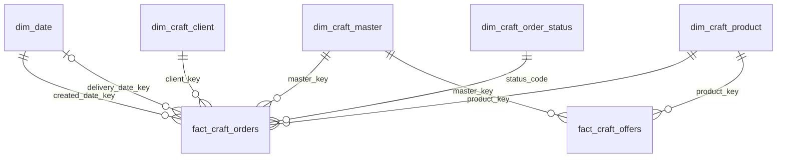
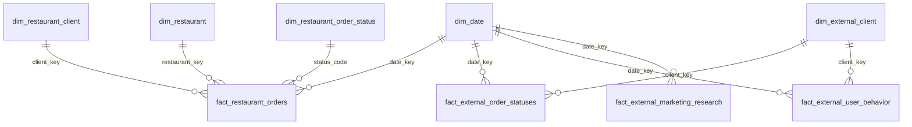

# Техническое задание для Codex: локальное хранилище данных в Docker Compose

Редакция 2: включает полное задание магазина изделий ручной работы, отдельную схему `external_source` и MongoDB ресторанного домена. Эта редакция заменяет прежнее описание таблиц и витрин. Если проект уже создан по первой редакции, расширить его новыми миграциями с сохранением существующих данных.

## 1. Задача и зафиксированные решения

Собери воспроизводимый локальный учебный проект, который запускается через Docker Compose: контейнеры, конфигурации, миграции, демонстрационные данные, загрузки Apache Airflow и проверка результата. Реализуй рабочую систему, а не только пример `compose.yaml` или план.

Архитектура согласована:

- Две бизнес-БД — источника: PostgreSQL и MongoDB.
- S3-совместимое хранилище — локальный MinIO, без AWS.
- STG физически находится в MinIO и сохраняет данные источников с минимальными преобразованиями.
- DDS физически находится в MinIO и обязательно моделируется отдельными таблицами фактов и измерений по схеме «звезда».
- CDM — подготовленные широкие или агрегированные витрины в формате Parquet, физически также в MinIO.
- ClickHouse предоставляет SQL-доступ к CDM через внешние таблицы `ENGINE = S3`. Бизнес-данные витрин не копируются в `MergeTree`.
- Основные JOIN и расчёт витрин выполняются в Trino до публикации Parquet.
- Apache Airflow управляет извлечением, преобразованиями, проверками и публикацией.
- PostgreSQL и ClickHouse мигрируются через Alembic, с независимыми окружениями и историями ревизий.

Обязательны все три части учебного задания: модель и месячная клиентская витрина магазина; подключение CSV через новую PostgreSQL-схему `external_source`; журнал изменений PostgreSQL и загрузка трёх коллекций MongoDB. Основной результат задания 1 — витрина `craft_customer_monthly` со всеми 17 перечисленными ниже полями и SQL-запрос для её расчёта.

Пользователь уточнил правила периода: показатели завершённых заказов группируются по `delivery_date`; счётчики создания и незавершённых заказов — отдельно по `order_date`; сумма оплаченных заказов клиента считается за всю историю, доступную на момент загрузки. Подробные формулы приведены в разделе 10.

Дополнительные решения этого ТЗ: Trino — единственный SQL-движок преобразований; Apache Iceberg — формат таблиц STG и DDS; Lakekeeper — Iceberg REST Catalog. Выбранный Iceberg для STG позволяет прямо читать исходные наборы через тот же Trino, без дополнительного Hive Metastore. Исходные документы сохраняются в STG в том числе полным JSON-представлением. Эти решения уточняют реализацию хранения на S3 и не меняют логическую модель DDS.

В первой версии обрабатываем небольшой учебный набор полными снимками сущностей. PostgreSQL `logs` сохраняет все зафиксированные изменения строк и загружается отдельным набором данных. MongoDB загружается полными снимками; захват каждой промежуточной версии MongoDB в эту версию не входит.



## 2. Состав Docker Compose

| Сервис | Назначение |
|---|---|
| `postgres-source` | Магазин в `public`, CSV-таблицы в `external_source`, общий `public.logs` и отдельная техническая история миграций |
| `mongo-source` | Коллекции `clients`, `orders`, `restaurant` |
| `minio` | Все файлы STG, DDS и CDM |
| `postgres-meta` | Служебные БД `airflow`, `iceberg_catalog`, `warehouse_control`, с отдельными пользователями |
| `lakekeeper` | Iceberg REST Catalog, состояние каталога в `postgres-meta` |
| `trino` | Один узел, coordinator с выполнением запросов; доступ к Iceberg через Lakekeeper и к MinIO |
| `clickhouse` | Внешние S3-таблицы витрин; собственный постоянный том для метаданных и возможного кеша |
| `airflow-api-server` | Интерфейс и API Airflow 3 |
| `airflow-scheduler` | Планировщик и выполнение Python-задач через `LocalExecutor` |
| `airflow-dag-processor` | Разбор DAG |
| `airflow-triggerer` | Добавить только если используются deferrable-задачи |

Одноразовые сервисы/задания: инициализация служебных БД, `minio-init`, собственная миграция БД Lakekeeper, `lakekeeper-init`, `postgres-migrate`, `mongo-migrate`, `lake-migrate`, `clickhouse-migrate`, `seed`, `airflow-init`, `smoke-test`.

Использовать стабильную версию Airflow 3 и корректный для неё набор сервисов и настроек. `LocalExecutor`, небольшое явно заданное `parallelism`, один активный запуск основного DAG. Redis, Celery, Kafka, Spark и отдельные BI-сервисы для этого проекта не нужны.

Все версии образов и зависимостей зафиксировать. Выбрать реально доступные совместимые релизы, проверить их документацию и записать версии в README. Не использовать `latest`, nightly или плавающие зависимости. Доработки образов и установка Python-пакетов выполняются при сборке, не при каждом старте контейнера.

Контейнеры обращаются друг к другу по DNS-именам Compose, например `http://minio:9000`; `localhost` внутри контейнера не обозначает другой сервис. Настроить path-style S3 там, где этого требуют MinIO и клиент. Проверить доступ к файлам и из Trino, и из PyIceberg, и из ClickHouse.

Для локальных интерфейсов предложены привязки к `127.0.0.1`: Airflow `8080`, Trino `8081`, MinIO API `9000`, MinIO Console `9001`, ClickHouse HTTP `8123`. Native-порт ClickHouse, если нужен, публиковать как `19000`, чтобы он не конфликтовал с MinIO. Порты источников и каталога сделать настраиваемыми или доступными через профиль отладки.

## 3. Постоянное состояние и конфигурация

Создать отдельные named volumes для PostgreSQL source, PostgreSQL meta, MongoDB, MinIO, метаданных ClickHouse и логов Airflow. Каталог Iceberg обязан переживать перезапуск вместе с файлами MinIO: одного сохранения Parquet недостаточно.

Предоставить `.env.example` без реальных секретов. Настройки адресов, имён БД, бакета, пользователей, паролей и часового пояса источников вынести в конфигурацию. Пользователи миграций, ETL и чтения витрин должны иметь разные назначения. Учётные данные MinIO не встраивать в SQL миграций или исходный код; для внешних таблиц ClickHouse использовать настроенную named collection либо эквивалентную конфигурацию сервера.

Служебные БД Airflow и Lakekeeper мигрировать штатными средствами этих продуктов. Не пытаться описывать их внутренние таблицы своими Alembic-моделями.

## 4. PostgreSQL: магазин и отдельная схема external_source

### 4.1. Задание 1: магазин изделий ручной работы

Референс исходной модели сохранён вместе с ТЗ: [handmade-source-model.png](C:/Users/timur/Documents/Codex/2026-10-16/rfr/outputs/handmade-source-model.png). Все таблицы и поля изображения также перечислены ниже, поэтому текст задания самодостаточен.

В `public` воспроизвести модель с предоставленной диаграммы:

| Таблица | Исходные поля диаграммы |
|---|---|
| `public.master` | `master_id` PK, `name`, `phone`, `address`, `birthday` |
| `public.product` | `product_id` PK, `name`, `description`, `type` |
| `public.master_product` | `id` PK, `master_id` FK, `product_id` FK, `price` |
| `public.client` | `client_id` PK, `name`, `phone`, `address`, `birthday` |
| `public."order"` | `order_id` PK, `master_id` FK, `product_id` FK, `client_id` FK, `order_date`, `delivery_date`, `status` |

`order` — исходное имя таблицы; в PostgreSQL SQL всегда использовать `public."order"`, поскольку имя совпадает с ключевым словом. В моделях SQLAlchemy корректно настроить quoting. Имена полей исходной схемы сохранить.



Идентификаторы — BIGINT, даты рождения — DATE, время заказа и завершения — TIMESTAMPTZ, деньги — NUMERIC(18,2). На `master_product(master_id, product_id)` установить UNIQUE; пару мастера и товара заказа проверять составным внешним ключом либо эквивалентным ограничением. Соединение только по `product_id` не должно размножать заказы разных мастеров.

Гранулярность исходной модели: один заказ содержит один товар одного мастера, количество по умолчанию равно 1. Массив `ordered_dish` из MongoDB относится к другому домену и сюда не переносится.

В диаграмме отсутствуют сведения, без которых нельзя корректно выполнить запрос задания 1. Явно расширить модель миграцией:

- `public.client.email TEXT` — email клиента, nullable для неполных реальных данных, заполнен в демонаборе;
- `public."order".order_price NUMERIC(18,2)` — стоимость заказа, зафиксированная при создании; для новых учебных заказов берётся из подходящей пары `master_product`;
- `public."order".paid_at TIMESTAMPTZ NULL` — момент полной оплаты; NULL означает, что заказ ещё не оплачен.

Стоимость исторического заказа не пересчитывать по текущей цене предложения. Для новых записей получать snapshot цены до вставки либо в отдельном BEFORE INSERT-триггере; AFTER-триггер журналирования должен увидеть уже заполненную стоимость. Изменение `master_product.price` не меняет `order_price` существующих заказов. При переносе уже существующих заказов без сохранённой цены историческая стоимость неизвестна: не выдавать текущую цену за достоверную историю; описать необходимый backfill и его допущение.

Признак оплаты не выводить из статуса завершения: оплаченный заказ может ещё изготавливаться, а завершённый — оставаться неоплаченным. В учебной модели `paid_at` означает полную оплату суммы `order_price`; частичные оплаты и возвраты потребуют отдельной модели платежей.

Согласовать статусы демонабора: `created`, `in_progress`, `delivery`, `done`, `cancelled`. При импорте варианта `in progress` приводить его к каноническому `in_progress`, сохраняя исходное значение в STG. `delivery_date` в этой модели — фактическое завершение: для `done` заполнена и не меньше `order_date`, для остальных статусов NULL. Плановая дата доставки этим полем не подменяется.

### 4.2. Задание 2: новая схема external_source

Создать именно отдельную PostgreSQL-схему `external_source`, а не другую БД или только S3-префикс. В ней разместить:

| Таблица | Поля |
|---|---|
| `external_source.order_statuses` | `id BIGINT PRIMARY KEY`, `date_time TIMESTAMPTZ`, `client_id BIGINT`, `quantity BIGINT`, `payment_amount NUMERIC(18,2)` |
| `external_source.user_behavior` | `id BIGINT PRIMARY KEY`, `date_time TIMESTAMPTZ`, `client_id BIGINT` |
| `external_source.marketing_research` | `id BIGINT PRIMARY KEY`, `date_id INTEGER`, `sales_qty BIGINT`, `sales_amt NUMERIC(18,2)` |

`id` — явно добавленный технический/исходный ключ для журналирования и повторных загрузок; перечисленные в задании бизнес-поля сохранить. Имена `Date_time`, `Client_id`, `Sales_qty` из описания нормализовать к нижнему регистру SQL, не создавать случайные варианты колонок, отличающиеся регистром.

Полные входные схемы CSV:

```text
order_statuses.csv:
id, date_time, city_id, city_name, client_id, first_name, last_name,
item_id, item_name, quantity, payment_amount

user_behavior.csv:
Id, date_time, behavior_id, user_id, quantity

marketing_research.csv:
date_id, category_id, sales_qty, sales_amt
```

Отображение в целевые таблицы:

- `order_statuses.csv`: `id`, `date_time`, `client_id`, `quantity`, `payment_amount`.
- `user_behavior.csv`: `Id -> id`, `date_time`, `user_id -> client_id`.
- `marketing_research.csv`: `date_id`, `sales_qty`, `sales_amt`, плюс детерминированный технический `id`.

Если исходные ID CSV неуникальны, выдавать диагностируемую ошибку или сохранять отдельный технический ключ и исходный ID с документированной гранулярностью; не удалять реальные дубли строк без основания.

CSV архивировать целиком в `s3://dwh/input/`. Дополнительные поля — город, товар, имена клиента, тип поведения, количество поведения, категория — по заданным структурам не включать молча в целевые таблицы. Сохранять исходные файлы для последующего расширения модели. Поле `product.type` магазина используется в его собственной витрине и не связано автоматически с CSV `category_id` или категорией `gold` из примера журнала.

В демоданных `date_id` явно определить как INTEGER YYYYMMDD. Остальные форматы требуют явного отображения или понятной ошибки. Все временные значения нормализовать к UTC; для наивных дат CSV использовать настраиваемый `SOURCE_TIMEZONE`.

Внутри `external_source` в демонаборе `user_id` поведения и `client_id` статусов относятся к одному пространству ID. Клиенты магазина, external_source и ресторанов — отдельные пространства идентификаторов, пока не предоставлено явное соответствие. Равенство чисел не доказывает, что это один человек.

## 5. PostgreSQL: журнал изменений

Создать `public.logs`:

- `id BIGINT GENERATED ALWAYS AS IDENTITY PRIMARY KEY` — идентификатор события журнала;
- `changed_at TIMESTAMPTZ NOT NULL DEFAULT clock_timestamp()` — время фиксации события триггером, не обещание порядка COMMIT;
- `object_schema TEXT NOT NULL` — схема изменённой таблицы, `public` или `external_source`;
- `object_type TEXT NOT NULL` — имя изменённой бизнес-таблицы;
- `object_value JSONB NOT NULL` — полная строка;
- `operation TEXT NOT NULL` — `INSERT`, `UPDATE`, `DELETE`, `TRUNCATE`.

Общая функция и строковые `AFTER INSERT OR UPDATE OR DELETE` триггеры:

- для INSERT/UPDATE сохраняют `to_jsonb(NEW)`;
- для DELETE сохраняют `to_jsonb(OLD)`;
- при откате исходной транзакции запись журнала также откатывается;
- изменение 10 строк создаёт 10 событий;
- сама `logs` и служебные таблицы миграций/управления не журналируются.

Журнал должен охватывать все пять таблиц магазина и все три таблицы `external_source`. Хранить имя схемы отдельно от `object_type`, чтобы исходное имя таблицы соответствовало условию. `object_schema` берётся из `TG_TABLE_SCHEMA`; ключ типа объекта в ETL — пара `(object_schema, object_type)`. Таблица `order` в JSON и журнале сохраняет своё имя без SQL-кавычек. Пример события `category` с полями `gold`, `percent`, `min_payment` иллюстрирует формат: он не задаёт связь с товарными категориями и не требует создавать недоописанный бизнес-справочник.

Для TRUNCATE реализовать `BEFORE TRUNCATE` с сохранением удаляемых строк и явно протестировать его. Не оставлять этот способ очистки незаметным для журнала. DDL и чтения не являются строковыми изменениями этого журнала.

Создание новой бизнес-таблицы и подключение к ней триггера включать в одну Alembic-миграцию. Не рассчитывать, что одноразовый обход существующих таблиц автоматически охватит будущие.

В миграциях перечислять бизнес-таблицы явно либо отделять их от технических схем. Историю Alembic хранить в `migration_meta`, исключённой из журналирования.

Если обновляется уже созданная версия стенда, добавление `object_schema`, перенос старых CSV-таблиц из `public` в `external_source` и изменение триггеров оформить отдельными миграциями. Старые события сохраняют фактическую схему на момент события; не переписывать историю журнала под новое расположение таблиц.

Первоначальные CSV загружать после установки триггеров. Повторный `seed` не должен повторно обновлять неизменившиеся строки и порождать новые события. Пропуски в последовательности `logs.id` после отката допустимы.

## 6. MongoDB: коллекции и связи

Создать коллекции явно через миграции, задать validators и необходимые индексы. Имена согласованы: `clients`, `orders`, `restaurant` — последнее в единственном числе.

`clients`:

- `_id: ObjectId`;
- `client_id: integer` — дополнительный бизнес-идентификатор для согласования с PostgreSQL и заказами;
- `name`, `phone`, `email`, `login`;
- `birthday`;
- необязательный `address` с `city`, `street`, `building`;
- `update_time`.

`restaurant`:

- `_id: ObjectId`;
- `restaurant_id: integer` — дополнительный бизнес-идентификатор;
- `name`, `phone`, `email`, `founding_day`, `address`.

`orders`:

- `_id: ObjectId`;
- `order_id`, `restaurant_id`, `client_id`;
- `order_date`;
- `ordered_dish` — исходный массив; его структуру сохранять в STG;
- `payed_by_bonuses`, `cost`, `payment`, `bonus_for_visit`;
- `final_status`, `update_time`.

Для демонстрационных данных генерировать валидные ObjectId. Строки вида `ObjectId("n856785vnh4n458nrf")` из задания являются условными примерами, а не валидными значениями ObjectId. `Array(2)` также заменить реальным демонстрационным массивом и сохранить его содержимое в STG.

Числовые `client_id` и `restaurant_id` у документов должны соответствовать ссылкам именно ресторанных заказов. Дополнительные числовые поля в `clients` и `restaurant` — явное расширение для такой связи. Не связывать числовой идентификатор с ObjectId путём приведения к строке, не сопоставлять клиентов по ФИО и не объединять ресторанного клиента с заказчиком магазина только из-за одинакового `client_id`.

В новых демодокументах время хранить BSON Date, а денежные значения — с точной десятичной семантикой. Для заданных ранее строк дат предусмотреть явный разбор известных форматов. Неизвестные значения должны приводить к диагностике, а не к молчаливому искажению данных. В STG сохранять полный документ в Extended JSON, чтобы не потерять BSON-типы.

Начальная модель ресторанных клиентов в DDS — SCD Type 1; историю исходных снимков хранит STG. Промежуточные версии MongoDB между снимками в этой реализации не гарантируются. Даты демонабора сделать согласованными, в том числе `update_time` не должен предшествовать созданию соответствующего заказа.

## 7. MinIO и каталог Iceberg

Создать бакет `dwh` и логическое разделение:

```text
s3://dwh/input/      исходные CSV, если они предоставлены
s3://dwh/stg/        файлы и метаданные исходных Iceberg-наборов
s3://dwh/dds/        файлы и метаданные таблиц звёзд
s3://dwh/cdm/        готовые обычные Parquet-файлы витрин
```

Реальные уникальные расположения Iceberg-таблиц может назначать каталог внутри соответствующего корневого расположения. Управлять таблицами через каталог; не подменять их регистрацию созданием пустых S3-префиксов.

Lakekeeper настроить по официальному минимальному примеру с MinIO и Trino, с постоянной PostgreSQL-БД каталога. Для изолированного локального стенда использовать минимальную схему аутентификации из поддерживаемого примера. Инициализация должна создавать warehouse и пространства имён идемпотентно и проверять доступ к MinIO. Не добавлять Keycloak только ради демостенда, если поддерживается минимальный режим без него.

Trino: один Iceberg REST catalog, например `lake`, пространства имён `stg` и `dds`; при необходимости отдельное `control`. Настроить совместимость Trino и PyIceberg с одним каталогом. Использовать Iceberg format version 2 для учебных таблиц, если выбранные версии поддерживают её совместно.

CDM — обычный Parquet, без Iceberg-метаданных. ClickHouse читает только CDM; прямое чтение каталога `data/*.parquet` Iceberg-таблицы запрещено, поскольку оно обходит снимки и удаления.

## 8. Логические наборы STG

Создать:

- `lake.stg.pg_public_master`;
- `lake.stg.pg_public_product`;
- `lake.stg.pg_public_master_product`;
- `lake.stg.pg_public_client`;
- `lake.stg.pg_public_order`;
- `lake.stg.pg_external_order_statuses`;
- `lake.stg.pg_external_user_behavior`;
- `lake.stg.pg_external_marketing_research`;
- `lake.stg.pg_logs`;
- `lake.stg.mongo_clients`;
- `lake.stg.mongo_orders`;
- `lake.stg.mongo_restaurant`.

Для снимков сохранять как минимум `batch_id`, `source_system`, `source_schema` для PostgreSQL, `source_pk`, `extracted_at`, полный `payload`, а также необходимые исходные поля в типизированных колонках для SQL-преобразований. `payload` в Iceberg допустимо хранить как VARCHAR с JSON/Extended JSON; PostgreSQL `logs.object_value` при этом остаётся JSONB в источнике. Оригинальные названия и значения полей не терять.

В `pg_logs` сохранять исходный `log_id`, `changed_at`, `object_schema`, `object_type`, `operation`, `object_value` и метаданные загрузки. Не подменять время события временем выгрузки.

`batch_id` должен быть стабилен для повторной попытки одного логического запуска Airflow. Для загрузок полных снимков использовать публикацию с заменой того же batch, а не повторным append. `pg_logs` загружать без дублей по исходному `log_id`. Для небольшого демонабора допустимо перечитывать журнал целиком с дедупликацией/MERGE. Не использовать наивное `id > MAX(ранее_загруженного_id)` как гарантию полноты при конкурентных транзакциях: выдача sequence ID и порядок COMMIT различаются.

Снимки всех таблиц PostgreSQL в рамках одного запуска читать в согласованной транзакции. Между PostgreSQL и MongoDB общей транзакции нет; сохранять время извлечения каждого источника.

Писать STG через PyIceberg/PyArrow либо совместимый проверенный путь записи в Iceberg. Не требуется отдельный Spark. Данные извлекать и передавать пакетами, а не бесконтрольно собирать весь источник в памяти.

## 9. DDS: обязательная схема «звезда»

Каждое измерение и каждый факт — отдельная Iceberg-таблица в MinIO. Не заменять DDS одной широкой таблицей или набором несвязанных JSON.

Измерения разделить по бизнес-доменам; общий календарь можно использовать во всех звёздах:

| Таблица | Логический ключ | Источник и атрибуты |
|---|---|---|
| `dim_date` | `date_key` = YYYYMMDD | Дата, год, квартал, месяц, день |
| `dim_craft_client` | `client_key` | `public.client`: исходный `client_id`, ФИО, телефон, адрес, дата рождения, email |
| `dim_craft_master` | `master_key` | `public.master`: `master_id`, ФИО, телефон, адрес, дата рождения |
| `dim_craft_product` | `product_key` | `public.product`: `product_id`, название, описание, `product_type` из `type` |
| `dim_craft_order_status` | `status_code` | Канонический статус заказа магазина |
| `dim_restaurant_client` | `client_key` | MongoDB `clients`: числовой `client_id`, `_id`, имя, контакты и адрес |
| `dim_restaurant` | `restaurant_key` | MongoDB `restaurant`: `restaurant_id`, `_id`, название и атрибуты |
| `dim_restaurant_order_status` | `status_code` | MongoDB `orders.final_status` |
| `dim_external_client` | `client_key` | Отдельное пространство `external_source.client_id`; атрибуты, которых нет в источнике, не выдумывать |

Для ключей использовать стабильное отображение исходного ID в пределах домена. Допустимы строковые ключи `craft:client:<id>`, `restaurant:client:<id>`, `external:client:<id>` и аналогичные ключи мастеров/товаров. Если используются BIGINT-ключи, хранить постоянную таблицу соответствий. Не генерировать ключи через меняющийся `row_number()` и не объединять численно совпавшие ID разных доменов.

Измерения описывают текущие доступные атрибуты (SCD Type 1); изменения категорий товара и клиентских атрибутов трактуются как актуализация справочников. Исторические варианты атрибутов остаются в STG, а SCD Type 2 потребует отдельного расширения. Цена заказа хранится непосредственно в факте как исторический snapshot.

Факты:

| Таблица | Гранулярность | Измерения | Данные |
|---|---|---|---|
| `fact_craft_orders` | Один текущий заказ `public."order"` | `created_date_key`, nullable `delivery_date_key`, `client_key`, `master_key`, `product_key`, `status_code` | `order_id`, `order_date`, `delivery_date`, `order_price`, `paid_at` |
| `fact_craft_offers` | Одна текущая пара мастера и товара из `master_product` | `master_key`, `product_key` | Исходный `id`, текущая `price`; цена предложения не является аддитивной мерой |
| `fact_restaurant_orders` | Один текущий заказ MongoDB | `date_key`, ресторанные `client_key`, `restaurant_key`, `status_code` | `order_id`, время заказа, `cost`, `payment`, показатели бонусов |
| `fact_external_order_statuses` | Одна текущая строка `external_source.order_statuses` | `date_key`, внешний `client_key` | Исходный `id`, время, `quantity`, `payment_amount` |
| `fact_external_user_behavior` | Одна текущая строка `external_source.user_behavior` | `date_key`, внешний `client_key` | Исходный `id`, время, `event_count = 1` |
| `fact_external_marketing_research` | Одна текущая строка исследования | `date_key` | Исходный `id`, `sales_qty`, `sales_amt` |

Звезда магазина:



Ресторанные и внешние звёзды:



Каждый факт — центр своей звезды. Ролевые ссылки на календарь не создают две физические копии `dim_date`. Связи логические, их корректность проверяет ETL. Не предполагать, что Iceberg обеспечивает внешние ключи PostgreSQL.

Внешняя `order_statuses` не содержит статуса, мастера, категории товара или подтверждённого ID заказа магазина/ресторана. Она не заменяет `public."order"` для задания 1. `product.type` магазина уже даёт категорию для его витрины, даже если в сокращённой внешней таблице отсутствует CSV `category_id`.

Состав `ordered_dish` сохраняется в STG. При появлении его точного контракта можно добавить факт ресторанных позиций, но не размножать сумму целого заказа на строки массива.

DDS в первой версии перестраивается по полным успешным снимкам текущего batch. PostgreSQL `logs` хранится отдельно как история событий: несколько обновлений одного заказа не создают несколько текущих заказов. Удалённые из источника сущности не остаются в новом текущем снимке. При нарушении ссылочной целостности прерывать публикацию с диагностикой проблемных ключей.

## 10. CDM: Parquet и внешние таблицы ClickHouse

### 10.1. Обязательная витрина задания 1: craft_customer_monthly

Гранулярность — один заказчик магазина × один отчётный месяц. Источники — только звезда магазина `fact_craft_orders` и её измерения. Подготовить полноценный выполняемый SQL на Trino в `sql/cdm/craft_customer_monthly.sql`, экспорт Parquet и внешнюю таблицу `cdm.craft_customer_monthly` в ClickHouse.

Также предоставить эталонный запрос PostgreSQL `sql/source/craft_customer_monthly.sql`, вычисляющий те же поля непосредственно из `public."order"`, `public.client`, `public.product` и при необходимости `public.master`. Сравнить результаты двух запросов на одних исходных данных. Таким образом требование «напишите запрос» выполняется отдельным SQL-файлом, а не только описанием Airflow.

Все 17 полей результата обязательны:

| № | Колонка | Содержание и тип |
|---|---|---|
| 1 | `id` | Стабильный VARCHAR-идентификатор пары клиент/месяц, например SHA-256 от доменного ключа и `report_period` |
| 2 | `client_id` | Исходный BIGINT ID заказчика магазина |
| 3 | `client_name` | ФИО из `public.client.name` |
| 4 | `client_address` | Адрес заказчика |
| 5 | `client_birthday` | Дата рождения, DATE |
| 6 | `client_email` | Email, nullable при отсутствии в источнике |
| 7 | `paid_orders_amount_all_time` | Сумма `order_price` всех полностью оплаченных заказов клиента за всю доступную историю, DECIMAL |
| 8 | `orders_count_month` | Число завершённых заказов отчётного месяца по `delivery_date`, BIGINT |
| 9 | `avg_order_amount_month` | Средняя зафиксированная стоимость этих заказов, DECIMAL, округление до 2 знаков |
| 10 | `median_completion_days_month` | Точная медиана времени от создания до завершения этих заказов, в днях, с дробной частью |
| 11 | `most_popular_category_month` | Самая частая категория `product.type` среди этих заказов |
| 12 | `most_popular_master_id_month` | Исходный BIGINT `master_id` самого частого мастера среди этих заказов |
| 13 | `created_orders_count_month` | Количество заказов, созданных по `order_date` в отчётном месяце, независимо от текущего статуса |
| 14 | `in_progress_orders_count_month` | Количество заказов, созданных в этом месяце и имеющих текущий статус `in_progress` |
| 15 | `completed_orders_count_month` | Количество заказов, завершённых по `delivery_date` в отчётном месяце |
| 16 | `unfinished_orders_count_month` | Количество заказов, созданных в этом месяце и имеющих текущий статус, отличный от `done` |
| 17 | `report_period` | Год и месяц в виде VARCHAR `YYYY-MM` |

Пользователь выбрал период завершения заказов, поэтому правила расчёта зафиксированы следующим образом:

1. **Группа завершения:** заказы `status = 'done'` и `delivery_date` в `[начало месяца, начало следующего месяца)`. По ней считать число заказов, среднюю стоимость, медиану, популярную категорию и мастера. Не фильтровать эту группу по дате создания или признаку оплаты. Заказ может быть создан в январе и попасть в показатели завершения февраля.
2. **Группа создания:** заказы с `order_date` в том же календарном интервале. По ней считать `created_orders_count_month`, а также текущие `in_progress` и `unfinished`. У незавершённых заказов нет фактической `delivery_date`, поэтому нельзя вычислять эти счётчики одним общим WHERE по завершению.
3. `created_orders_count_month` — все создания месяца, а не только строки со статусом `created`. `unfinished` в этой версии означает `status <> 'done'`, включая `cancelled`; это пересекающийся показатель, а не дополнительная непересекающаяся категория. Статусы берутся на момент текущего batch, а не восстанавливаются на конец исторического месяца.
4. В выбранном определении `orders_count_month` и `completed_orders_count_month` совпадают. Сохранить оба запрошенных поля и описать равенство; не менять период ради искусственного различия этих колонок.
5. **Все оплаченные заказы:** отдельный агрегат по клиенту за всю историю снимка, `paid_at IS NOT NULL`, с суммой `order_price`. Он не ограничивается отчётным месяцем и не требует статуса `done`. Одна и та же историческая сумма повторяется во всех месячных строках клиента.
6. Набор строк отчёта — UNION пар клиент/месяц из группы создания и группы завершения. Клиент с незавершёнными заказами и без завершений всё равно получает строку месяца создания. Клиент без каких-либо заказов не получает искусственных месяцев. При необходимости ограничения периода применять его к итоговым месяцам; агрегат полной оплаты остаётся за всю историю.
7. В месяце без завершённых заказов количества равны 0, средняя, медиана, популярная категория и мастер — NULL. Сумма оплат при отсутствии оплат равна 0. Не заменять отсутствующую среднюю или медиану нулевой длительностью/стоимостью.
8. Время считать в документированном `REPORT_TIMEZONE`, по умолчанию UTC, через границы календарных месяцев; не использовать приближение «30 дней». Стоимость брать из snapshot `order_price`. Категория берётся из `dim_craft_product.product_type`, не из external_source или примера `category = gold`.
9. Популярность — количество заказов, не сумма оплат. При равенстве категорий выбирать наименьшее лексикографически непустое значение, при равенстве мастеров — минимальный числовой `master_id`. Если категория неизвестна у всех заказов, результат NULL. Порядок выбора должен быть детерминированным.
10. Медиана точная: для нечётного числа интервалов средний элемент отсортированного ряда, для чётного — среднее двух центральных. Интервал в днях вычислять из реального времени с точностью минимум до миллисекунд, а не усечённым количеством календарных дней. Для Trino подходит `array_agg(duration_days ORDER BY duration_days)` с выбором центральных элементов; `approx_percentile` не использовать как замену точной медианы. В эталонном PostgreSQL допустим `percentile_cont(0.5) WITHIN GROUP`. Округление результата, например до 4 знаков дней, применять после вычисления медианы. Отрицательный интервал является ошибкой данных.
11. Сначала получить независимые агрегаты завершений, созданий, оплат и рейтингов, затем соединять их по уникальным ключам. `master_product` не должен размножать строки заказов; факты предложений не подмешиваются в расчёт суммы исторических заказов. Уникальность `(client_id, report_period)` и стабильность `id` проверяются.

### 10.2. Дополнительные витрины остальных источников

Рассчитать в Trino:

| Витрина | Гранулярность | Показатели |
|---|---|---|
| `restaurant_daily_sales` | День × ресторан | Для ресторанных `final_status = 'closed'`: `orders_count`, `cost_total`, `payment_total`, `bonus_for_visit_total` |
| `external_client_activity_daily` | День × внешний клиент | Количество событий поведения, количество/сумма из внешней order_statuses; факты агрегируются раздельно перед JOIN |
| `marketing_daily_sales` | День | Суммы внешних `sales_qty` и `sales_amt` |
| `external_order_statuses_daily` | День × внешний клиент | Суммы `quantity` и `payment_amount` из внешнего факта |

Не объединять ресторанные заказы и поведение клиентов external_source без заданного соответствия. Внутри внешнего домена учитывать дни только с поведением и только со статусами, не соединять сырые многозначные факты и не допускать размножения сумм. Денежные показатели разных доменов не складывать автоматически.

### 10.3. Публикация пяти витрин

Экспортировать результаты Trino пакетами через Python/PyArrow в обычный Parquet с явной схемой и точными Decimal-типами. Первая версия рассчитана на небольшой учебный набор: один опубликованный файл на каждую из пяти витрин:

```text
s3://dwh/cdm/craft_customer_monthly/current.parquet
s3://dwh/cdm/restaurant_daily_sales/current.parquet
s3://dwh/cdm/external_client_activity_daily/current.parquet
s3://dwh/cdm/marketing_daily_sales/current.parquet
s3://dwh/cdm/external_order_statuses_daily/current.parquet
```

Сначала полностью сформировать временный файл и проверить результат, затем загрузить/заменить итоговый объект. Не очищать рабочий путь перед началом выгрузки и не читать glob, включающий старые выгрузки. При ошибке вычисления или подготовки файла предыдущая опубликованная витрина должна оставаться доступной. Публикация разных витрин не является одной распределённой транзакцией; сохранять статус batch в управляющей БД. Для перехода к нескольким файлам потребуется отдельно реализовать версионирование набора и переключение активной версии.

В ClickHouse создать БД `cdm` и пять одноимённых таблиц с явно заданными колонками, каждая `ENGINE = S3` с точным URL `current.parquet` и форматом Parquet. Главная таблица `cdm.craft_customer_monthly` содержит все 17 полей задания 1. Настройки подключений передавать через named collection. Пустые корректные Parquet-файлы для начальной доступности таблиц может создавать bootstrap; никогда не записывать пустой файл поверх существующей опубликованной витрины.

ClickHouse не пересчитывает звезду и не выполняет основные JOIN DDS. Не нужны materialized views для автоматического отслеживания изменений S3. Кеш чтения допустим, но повторное чтение после замены объекта должно показывать актуальный файл; это проверить. Локальные технические таблицы истории Alembic допустимы и не являются локальным хранением бизнес-CDM.

## 11. Миграции и инициализация

- **PostgreSQL source:** Alembic, отдельный `alembic-postgres.ini`, каталог ревизий, PostgreSQL-драйвер. Магазин `public`, схема `external_source`, расширения email/оплаты/snapshot цены, ключи, индексы, `logs` и триггеры версионируются. PL/pgSQL и триггеры писать явным SQL через `op.execute()`; не рассчитывать на их стандартный autogenerate. Если есть первая версия проекта, перенос таблиц и смену контрактов оформлять новыми ревизиями, сохраняя данные.
- **ClickHouse:** отдельный `alembic-clickhouse.ini`, независимые ревизии и история; использовать совместимую версию SQLAlchemy-диалекта с Alembic-интеграцией, например проверенный релиз `clickhouse-connect`. Для S3-DDL допустимы ручные операции. Не предполагать транзакционный откат всех DDL.
- **MongoDB:** `migrate-mongo` с зафиксированной версией, отдельными changelog/lock коллекциями; миграции коллекций, validators и индексов. Автоматическое создание коллекции первой вставкой не заменяет эти миграции.
- **MinIO:** идемпотентный bootstrap бакета и доступа. Существующий бакет и данные сохраняются.
- **STG/DDS:** отдельные версионируемые миграции Iceberg через Trino SQL или PyIceberg. Для первой реализации допускается небольшой Python-runner, сохраняющий номер, checksum, статус и время миграции в `warehouse_control`, с блокировкой от параллельного запуска. Историю служебной БД управления также версионировать. После частичного внешнего DDL повторный запуск должен корректно завершать миграцию; одного `IF NOT EXISTS` недостаточно для проверки совпадения схемы.
- **Управляющая БД:** собственное окружение Alembic для технических таблиц `warehouse_control`; оно отделено от исходной PostgreSQL и ClickHouse.
- **Airflow/Lakekeeper:** штатные миграции соответствующих продуктов.

Применённые миграции не редактировать: добавлять новую ревизию. Поддержать вывод текущего состояния миграций. Миграция создания новой бизнес-таблицы PostgreSQL сразу устанавливает журналирование. Проверить повторный запуск всей подготовки на существующих volumes.

Все операции не находятся в одной общей транзакции. При ошибке остановить зависимые шаги, сохранить диагностику и позволить продолжить после исправления. Инициализация окружения и загрузка данных — отдельные процессы; обычный ETL не запускает все миграции на каждом выполнении.

## 12. Порядок старта

Использовать проверяемые healthchecks, `depends_on: condition: service_healthy` для постоянно работающих зависимостей и `service_completed_successfully` для init/migration jobs. Не заменять готовность фиксированными `sleep`.

Реализовать порядок без циклических зависимостей:

1. Запустить PostgreSQL source, PostgreSQL meta, MongoDB, MinIO и ClickHouse.
2. Подготовить служебные БД/пользователей, бакет MinIO и выполнить штатную миграцию Lakekeeper.
3. Запустить Lakekeeper, создать warehouse и проверить файловый доступ.
4. Запустить Trino с настроенным Iceberg catalog.
5. Применить миграции источников, управляющей БД и таблиц STG/DDS.
6. Подготовить отсутствующие пустые CDM Parquet и применить миграции ClickHouse.
7. Идемпотентно наполнить источники демоданными либо предоставленными файлами.
8. Выполнить `airflow-init`, установить Connections и запустить постоянные сервисы Airflow.
9. Основной DAG доступен для ручного запуска. Для первоначального end-to-end примера предоставить явную команду.

Учесть, что уже завершившийся init-контейнер не гарантирует автоматическое применение новых миграций при любом последующем `up`. Предоставить отдельную команду обновления/повторного запуска migration jobs для существующего окружения. Не использовать только `/docker-entrypoint-initdb.d` как механизм эволюции схемы.

## 13. DAG Airflow

Один основной DAG, например `warehouse_pipeline`, `catchup=False`, `max_active_runs=1`; расписание настраиваемое, начально ручное.

Задачи и зависимости:

```text
check_dependencies
    -> extract_postgres_snapshot_and_logs ─┐
    -> extract_mongo_snapshot ─────────────┤
                                          -> validate_stg
                                          -> build_dimensions
                                          -> build_facts
                                          -> validate_dds
                                          -> calculate_and_publish_cdm
                                          -> verify_clickhouse
                                          -> mark_batch_success
```

Две задачи извлечения могут выполняться независимо; после них требуется общий барьер. Через XCom передавать только небольшие идентификаторы и метаданные, а не наборы данных. Состояние batch и контрольные количества сохранять в `warehouse_control`. При сбое не помечать весь запуск успешным. Повторная попытка и повторная обработка одних исходных данных не должны удваивать события или показатели. Заменяемые текущие снимки публиковать последовательно; завершённость всего DDS-batch проверять до расчёта CDM, не обещать транзакцию на все Iceberg-таблицы сразу.

Извлечение PostgreSQL охватывает магазин, external_source и общий журнал. Внутри `calculate_and_publish_cdm` выделить расчёт `craft_customer_monthly`, остальные четыре витрины и проверки их результата. `verify_clickhouse` обязательно читает все 17 полей главной витрины и сравнивает её с ожидаемыми данными; отдельный интеграционный тест сравнивает Trino DDS и эталонный PostgreSQL-запрос.

## 14. Демоданные

Если реальные CSV/документы отсутствуют, создать небольшой детерминированный набор для всех трёх заданий:

- Магазин: несколько мастеров, клиентов и товаров минимум трёх категорий, один товар у нескольких мастеров, предложения с разными ценами, заказы разных статусов минимум за три отчётных месяца.
- Заказ, созданный в одном месяце и завершённый в следующем; клиент только с незавершёнными заказами и NULL `delivery_date`; заказ со статусом `in_progress`; оплаченный незавершённый и неоплаченный завершённый заказы.
- Клиент с оплатами в разных месяцах, чтобы проверить сумму за всю историю. Клиенты с равенством популярности категорий/мастеров для проверки tie-break.
- Наборы с чётным и нечётным количеством длительностей; дробная длительность, например 1,5 дня; для чётного набора `[1, 3]` дня ожидаемая медиана 2, для нечётного `[1, 1, 10]` — 1.
- External_source: все три CSV, один внешний клиент с несколькими строками статусов и поведения за один день, дни только с одним видом активности.
- MongoDB: несколько клиентов, ресторанов и согласованных заказов разных статусов. Один числовой `client_id` намеренно совпадает с ID другого человека в магазине и external_source — это тест изоляции доменов.

Зафиксировать исходные записи, точные ожидаемые результаты `craft_customer_monthly` и пояснения к ним в `seeds/` и `tests/fixtures/`; одних проверок «строки появились» недостаточно. Денежные, календарные и статусные значения согласовать с контрактами. Изменение текущей цены предложения должно оставлять исторические суммы заказов прежними.

Генератор seed запускать явно. Повторный запуск не создаёт дублей, новых произвольных ObjectId для уже существующих сущностей и дополнительных неизменившихся событий `logs`. Для CSV поддержать предоставленные названия колонок и документировать правила преобразования.

## 15. Структура репозитория и результат

Предоставить как минимум:

```text
compose.yaml
.env.example
README.md
docker/                    Dockerfile и конфигурации сервисов
bootstrap/                 инициализация MinIO, каталога, служебных БД
migrations/postgres/       Alembic: исходная PostgreSQL
migrations/clickhouse/     Alembic: внешние таблицы витрин
migrations/mongo/          migrate-mongo
migrations/lake/           Iceberg STG/DDS и история их изменений
migrations/control/        управляющие служебные таблицы
src/                       извлечение, запись Iceberg, экспорт Parquet
sql/source/                эталонный PostgreSQL-запрос craft_customer_monthly.sql
sql/dds/                   отдельные звёзды магазина, ресторанов и external_source
sql/cdm/                   Trino-запрос craft_customer_monthly.sql и остальные витрины
dags/                      DAG и зависимости Airflow
seeds/                     детерминированные таблицы магазина, CSV и MongoDB-документы
tests/fixtures/            точные ожидаемые месячные отчёты
tests/integration/         проверки работающего стенда
```

В README: архитектурная схема, версии, физическое размещение каждого слоя, команды первого запуска, миграций, seed, DAG, проверки и обычной остановки. Дать команды для Docker Desktop/Compose на Windows и обычного Linux. Использовать относительные переносимые bind mounts и named volumes. Явно отделить остановку с сохранением данных от удаления volumes; обычный запуск и остановка данные не удаляют.

Административные операции выполняются из контейнеров; на хосте обязательны только Docker и Compose. Не требовать ручной установки Java, Python, Node.js, PostgreSQL или Trino. Секреты не включать в репозиторий.

## 16. Критерии приёмки

1. `docker compose config` проходит; все образы собираются или скачиваются с зафиксированными версиями.
2. Чистый запуск создаёт пять таблиц магазина, отдельную схему `external_source` с тремя таблицами, три коллекции MongoDB, общий журнал, каталог, STG/DDS и внешние таблицы ClickHouse, без ручного ввода DDL.
3. Повторная подготовка и seed на существующих volumes не создают дублей и не уничтожают данные.
4. На работающей PostgreSQL проверены INSERT, UPDATE, DELETE, многострочное изменение, первоначальный COPY/импорт, TRUNCATE и откат транзакции. События создаются для обеих бизнес-схем, содержат корректные `object_schema`, `object_type` и полный JSON. Откатившиеся изменения в `logs` отсутствуют; служебные таблицы не журналируются.
5. DAG успешно выполняется на seed: в MinIO есть файлы и метаданные Iceberg, в каталоге — отдельные факты/измерения, ссылочная целостность и гранулярность проверены.
6. `pg_logs` не содержит дублей `log_id`, а события журнала не учитываются как новые текущие сущности DDS.
7. В MinIO созданы пять обычных Parquet CDM, а S3-таблицы ClickHouse возвращают ожидаемые показатели. В `cdm.craft_customer_monthly` присутствуют все 17 полей; бизнес-копии CDM в MergeTree нет.
8. Повторный запуск DAG на неизменённых источниках сохраняет те же бизнес-показатели. Обновление оплаты заказа меняет итог, не увеличивая количество заказов; удаление исходной записи корректно отражается после следующего снимка.
9. Тест «несколько строк статусов и несколько событий внешнего клиента за день» подтверждает отсутствие размножения сумм в `external_client_activity_daily`. Несколько предложений разных мастеров по одному товару не размножают `fact_craft_orders` и месячную витрину.
10. При ошибке расчёта/подготовки новой витрины её предыдущий опубликованный Parquet остаётся читаемым. После исправления повторный запуск завершается корректно.
11. Перезапуск контейнеров сохраняет бизнес-данные, историю миграций, метаданные каталога и доступность таблиц.
12. Реальный SQL-запрос PostgreSQL и расчёт через Trino DDS дают одинаковые 17 полей на golden-наборе; сортировка строк и допустимая точность округления заданы явно.
13. Заказ, созданный в январе и завершённый в феврале, учитывается в завершениях февраля и в счётчике созданий января. Клиент только с незавершёнными заказами имеет месячную строку, NULL-среднюю/медиану и ненулевые соответствующие счётчики.
14. Оплаченный незавершённый заказ входит в сумму оплат за всю историю, а неоплаченный завершённый не входит в неё. Сумма за историю одинакова во всех месячных строках клиента на одном batch.
15. Точная медиана проверена на чётных/нечётных наборах и дробных днях. При равенстве популярности выбор категории и мастера детерминирован. Повторный запуск сохраняет `id` строки клиент/месяц.
16. Изменение `master_product.price` не меняет исторический `order_price` и показатели старых заказов. Завершённые заказы без даты завершения или с отрицательной длительностью приводят к явной ошибке качества данных.
17. Численно одинаковые клиентские ID магазина, external_source и MongoDB не объединяются. Внешняя `order_statuses` не используется как замена таблице заказов магазина.
18. При обновлении существующего проекта изменения внесены новыми миграциями; исходные таблицы и данные не уничтожены для пересоздания стенда.
19. В финальном отчёте отдельно указаны реально выполненные проверки и ограничения среды. Если Docker недоступен, не утверждать, что интеграционные тесты прошли: сохранить реализацию, выполнить доступные статические проверки и перечислить команды для проверки стенда.

## 17. Официальные источники для реализации

- [Docker Compose: порядок запуска и readiness](https://docs.docker.com/compose/how-tos/startup-order).
- [Airflow: запуск в Docker](https://airflow.apache.org/docs/apache-airflow/stable/howto/docker-compose/index.html) и [LocalExecutor](https://airflow.apache.org/docs/apache-airflow/stable/core-concepts/executor/local.html). Официальный пример использует Celery: адаптировать его к LocalExecutor, а не копировать Redis/worker без необходимости.
- [Lakekeeper: начало работы](https://docs.lakekeeper.io/getting-started/) и [подключение Trino/PyIceberg](https://docs.lakekeeper.io/docs/latest/engines/).
- [Trino: Iceberg connector](https://trino.io/docs/current/connector/iceberg.html).
- [Trino: агрегатные функции](https://trino.io/docs/current/functions/aggregate.html), [массивы](https://trino.io/docs/current/functions/array.html) и [даты/время](https://trino.io/docs/current/functions/datetime.html) — для точной медианы, месячных границ и независимых агрегатов.
- [PyIceberg: Python API, запись через Arrow](https://py.iceberg.apache.org/api/).
- [ClickHouse: S3 table engine](https://clickhouse.com/docs/engines/table-engines/integrations/s3) и [интеграция SQLAlchemy/Alembic](https://clickhouse.com/docs/integrations/language-clients/python/sqlalchemy).
- [Alembic: документация](https://alembic.sqlalchemy.org/en/latest/) и [ограничения autogenerate](https://alembic.sqlalchemy.org/en/latest/autogenerate.html).
- [PostgreSQL: функции триггеров](https://www.postgresql.org/docs/current/plpgsql-trigger.html) и [транзакционное поведение триггеров](https://www.postgresql.org/docs/current/trigger-definition.html).
- [MongoDB: создание коллекций](https://www.mongodb.com/docs/manual/reference/method/db.createcollection/), [ObjectId](https://www.mongodb.com/docs/manual/reference/method/objectid/) и [migrate-mongo](https://github.com/seppevs/migrate-mongo).

При реализации проверяй документацию именно зафиксированных версий. Если несовместимость требует замены конкретного драйвера или версии, сохрани согласованные архитектурные границы и объясни техническую замену в README.
